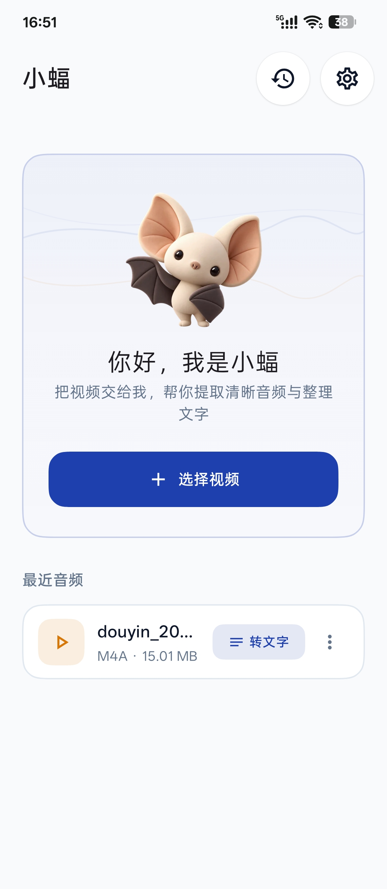
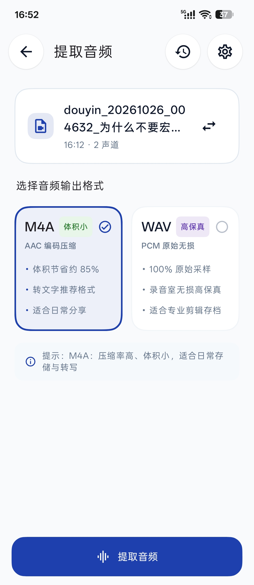
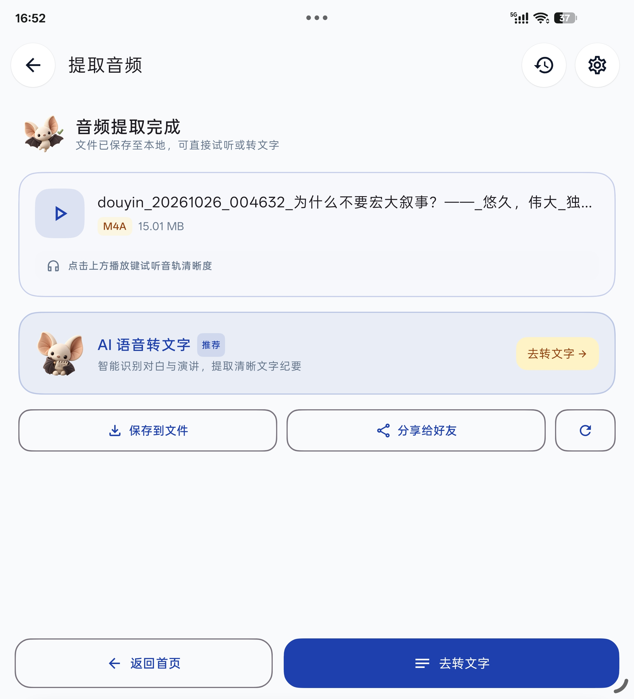
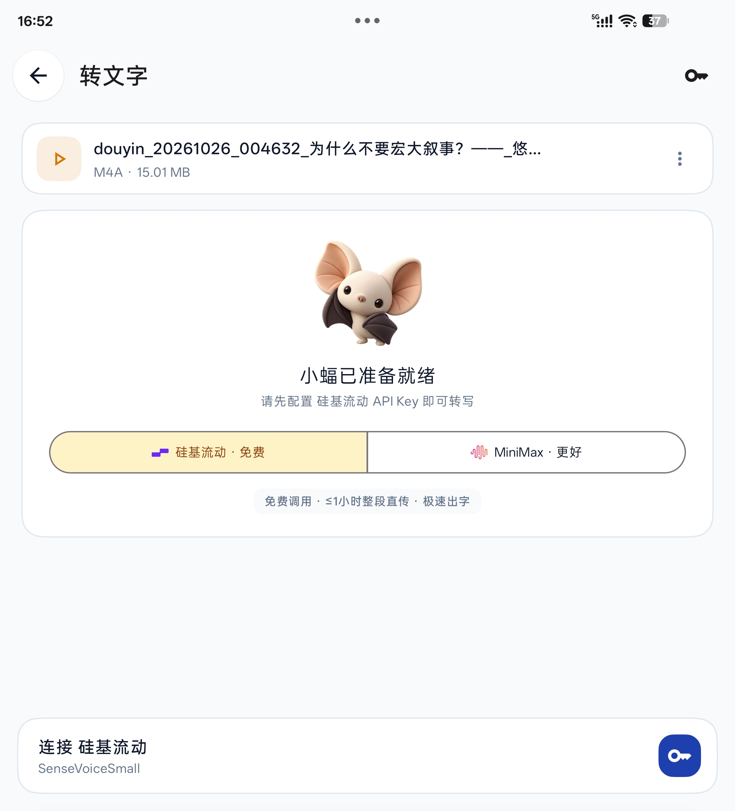
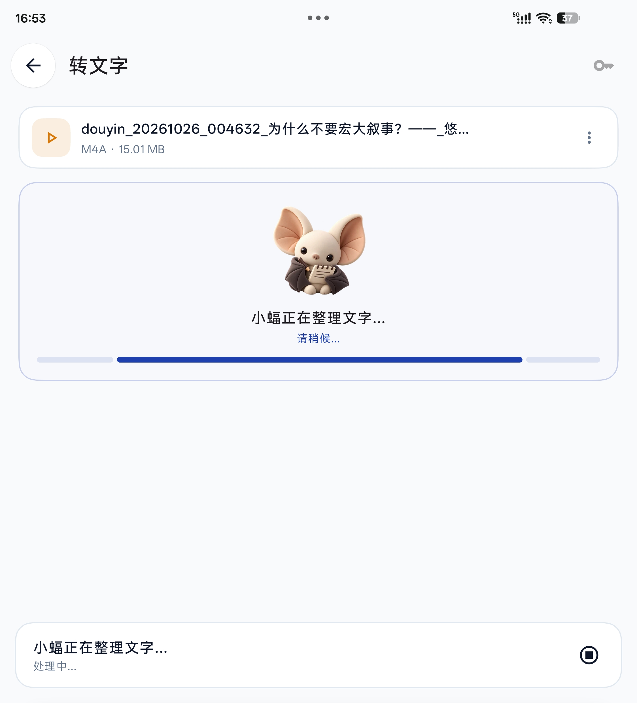
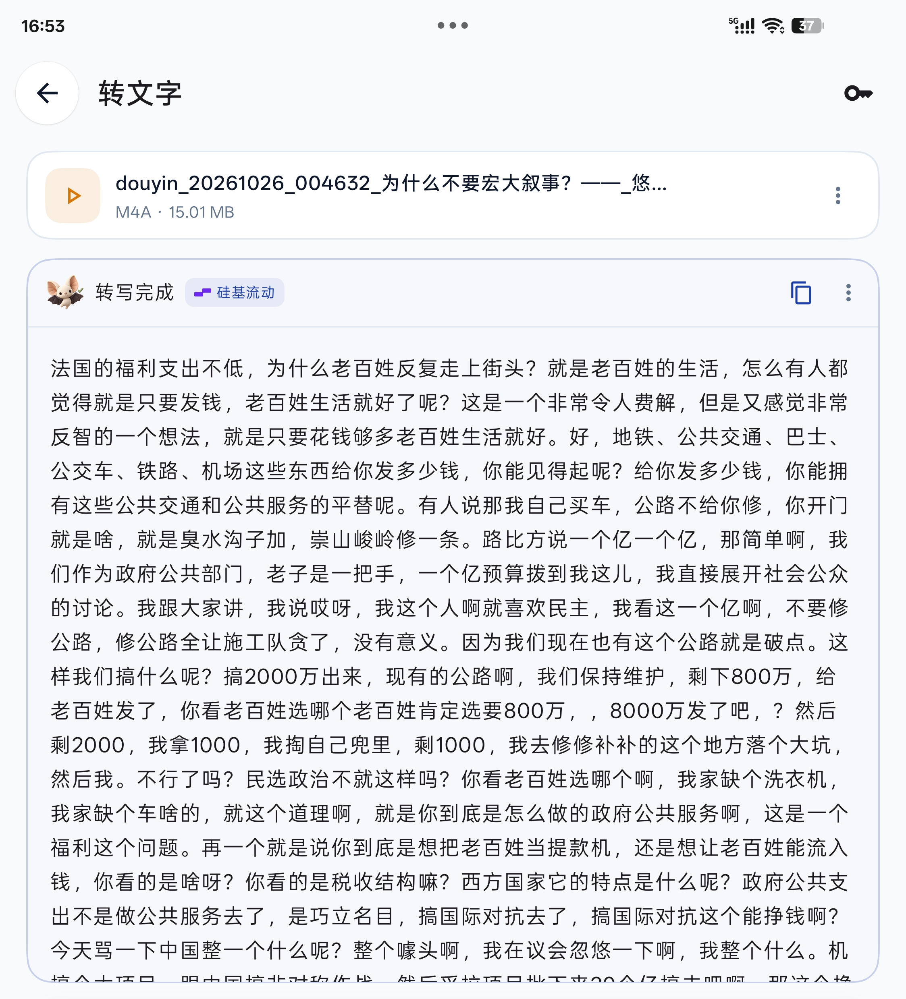
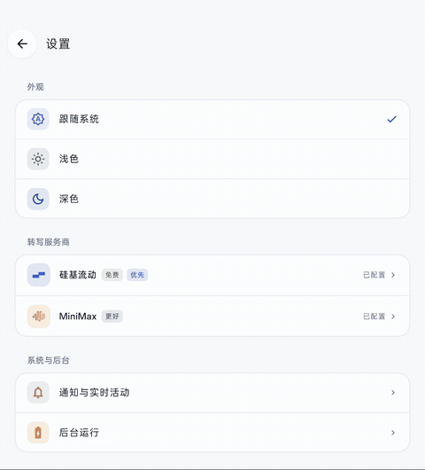
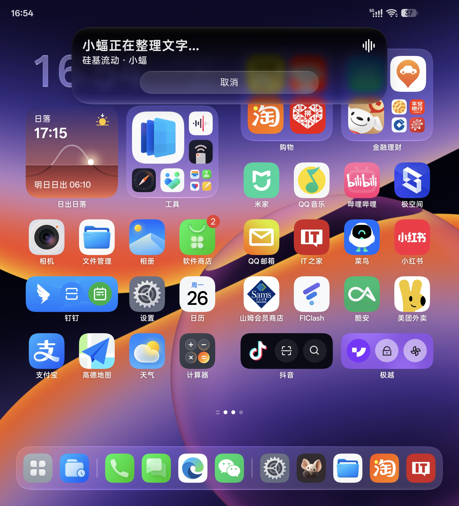
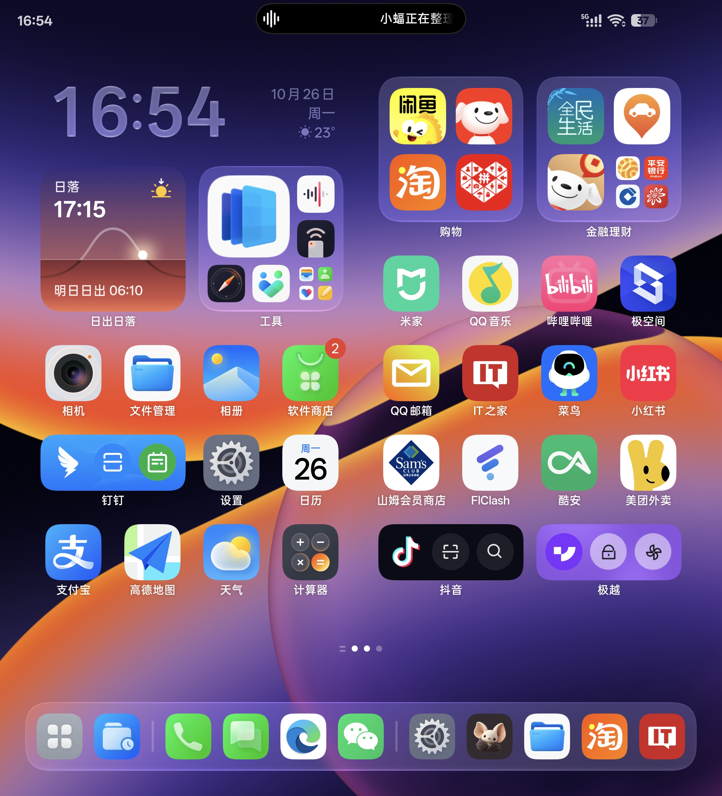

<div align="center">


# 小蝠 XiaoFu

**纯本地「视频提取音频」· AI 语音转文字（双大模型 ASR）· 原生预测式返回与全贝塞尔曲面**

<p align="center">
  <sub>Local Video-to-Audio Extractor & Speech-to-Text (ASR) App built with Jetpack Compose</sub>
</p>

[](https://developer.android.com/)
[-green?style=flat-square&logo=android)](https://developer.android.com/)
[](https://kotlinlang.org/)
[](https://developer.android.com/jetpack/compose)
[](https://github.com/Jolly-J/XiaoFu/releases)
[](LICENSE)

*把视频交给我，帮你提取清晰音频与整理文字。*

</div>

---

## 🦇 为什么做小蝠？

日常在手机上遇到优质短视频、播客回放、会议录屏或学习讲座时，很多时候我们其实只需要**里面的声音**或者**提取后的文本纪要**。然而市面上的工具往往让人痛苦不堪：

1. **强行传云端与隐私黑盒**：很多提取工具要求把整个视频先上传到第三方的私有服务器转码，几十兆甚至数吉字节的视频上传极慢，流量消耗巨大，个人隐私与工作敏感录屏毫无安全保障；
2. **格式粗糙与音质阉割**：要么强制把好端端的音轨二次重编码成劣质 MP3 导致音质失真，要么缺少透明的格式特性选择；
3. **语音转文字（ASR）昂贵繁琐**：市面上的录音转文字软件动辄按月收费，或者捆绑高额会员。而开发者想用最新的开源语音大模型（如 SenseVoiceSmall），又得在电脑上配置 Python 和命令行，普通手机用户根本无从下手；
4. **粗糙生硬的交互体验**：传统 Android 工具应用大都界面杂乱、机械直角切页、按钮挤作一团，毫无美感可言。

**小蝠（XiaoFu）** 就是为了终结上述痛点而打造的 Android 智能音频伴侣：
> **“视频音轨 100% 在手机本地无损抽取，零服务器中转、零隐私泄露；内置直连中国站硅基流动（官方免费）与 MiniMax 双语音大模型，用户自带 Key 极速转文字；全界面采用苹果级 G2 连续性贝塞尔超椭圆与 Android 14+ 原生预测式返回动效。”**

---

## 📸 界面一览与动态效果

### 1. 核心工作流：从视频到双格式音频

| 主界面 (小蝠极简萌趣) | 选择音频格式 (M4A / WAV 双卡片) | 音频提取完成 (沉浸试听与操作) |
| :---: | :---: | :---: |
|  |  |  |

### 2. 双 AI 语音大模型转文字 (ASR)

| 选择转写服务商 (自选 Key) | 智能分段流式转写中 | 纯净排版转写结果卡片 |
| :---: | :---: | :---: |
|  |  |  |

### 3. 系统级深度体验与非线性动效

| Android 14 预测式返回与弹性阻尼 (动图) | 系统级锁屏与通知栏实时活动 (Live Activity) | 原生流体云灵动指示 |
| :---: | :---: | :---: |
|  |  |  |

---

## ✨ 核心亮点

### 🚀 1. 纯本地硬件加速，零流量无损抽轨
- **设备本地直出**：采用底层 Android `MediaExtractor` 与 `MediaCodec` 硬件流水线，直接从 MP4/MOV/MKV/WebM 等视频容器中剥离音轨，不需要解码视频画面，百兆视频秒级完成；
- **零网络中转**：提取过程无需连网，不消耗任何数据流量，隐私数据坚决不出手机。

### 🎛️ 2. 双音频格式特性卡片 & 平滑横滚
- **M4A (AAC 编码压缩 · 体积小)**：
  - 采用 AAC 格式，体积相较于原始音频缩减约 85%，兼具极佳的便携性与兼容性，推荐用于日常存储、微信分享与 AI 语音转文字；
- **WAV (PCM 原始采样 · 高保真)**：
  - 100% 还原音轨全部细节，录音室级无损音质，适合专业音频后期与母带存档；
- **横向平滑滚动（AnimatedContent）**：
  - 从“格式配置”到“正在提取”再到“提取完成”，操作区采用横滚滑动转场与苹果非线性缓动，彻底消除突兀闪烁。

### 🤖 3. 双 AI 语音大模型自由选择
- **硅基流动 (SiliconFlow) 正式接入**：
  - 接入官方 SenseVoiceSmall 语音大模型，手机客户端直连中国站 API，响应快如闪电；
  - **官方免费调用**，无需为账户预充值费用；自带大文件动态切片保护（1 小时 / 45MB 双限安全策略）；
- **MiniMax 语音大模型通道保留**：
  - 保留高精度转写能力，清晰透明展示约 2.5 元/小时的资费说明；
- **去杂收纳与隐私密钥**：
  - 密钥使用 Android Keystore 独立加密持久化，互不干扰；转写结果卡片顶栏精炼展示，高频次级操作统一收拢至下拉菜单。

### 🍏 4. 苹果级贝塞尔圆角与预测式返回
- **全贝塞尔连续曲线（Continuous Corner Shape）**：
  - 放弃原生生硬机械圆弧，全界面容器、对话框与按钮均采用 G2 连续性超椭圆曲线（Squircle），曲线平滑无棱角；
- **非线性预测式返回（Predictive Back）**：
  - 适配 Android 14+ 原生预测式返回手势，采用 `CubicBezierEasing(0.12f, 0.96f, 0.22f, 1.0f)` 阻尼曲线与多层位移，滑动时露出底层页面，松手自然回弹。

### 📲 5. 原生实时活动（Live Activity）与前台服务
- **长任务后台保活**：接入系统前台服务通知（Ongoing Notification），切出后台不被杀死，锁屏与通知栏实时透明追踪当前处理百分比；
- **流体云胶囊联动**：支持系统级灵动胶囊交互，在桌面随时掌握当前转写动态。

---

## 🛠️ 技术选型与架构

小蝠基于纯原生现代 Android 体系打造，追求极简、高内聚与零冗余依赖：

```text
dev.local.audio
├── AudioEngine.kt                  # 基于 MediaExtractor / MediaMuxer 的本地音轨抽取核心
├── AsrProvider.kt                  # ASR 统一服务商协议、能力模型与元数据
├── SiliconFlowProvider.kt          # 硅基流动 SenseVoiceSmall 直连实现 (切片保护/流式上传)
├── MiniMaxProvider.kt              # MiniMax 语音大模型通道适配
├── ContinuousCorners.kt            # G2 连续性贝塞尔超椭圆 Squircle 形状实现
├── SmoothBackHost.kt               # 预测式返回 (Predictive Back) 手势驱动与非线性阻尼控制器
├── MainActivity.kt                 # 提取工作区、多状态机流转与沉浸播放器
├── TranscriptionScreen.kt          # 转写结果卡片、去杂收纳与下拉菜单
├── SettingsContent.kt              # 服务商偏好选择、资费说明与系统深浅色外观
├── ApiKeySettingsDialog.kt         # 独立 API Key 存储弹窗与官网申请引导
└── TranscriptionService.kt         # 系统前台服务与锁屏/通知栏实时活动 (Live Activity)
```

- **开发语言**：Kotlin 2.0
- **UI 体系**：Jetpack Compose (BOM 2025.04.01) + Material Design 3
- **异步调度**：Kotlin Coroutines + StateFlow 响应式状态流
- **音视频编解码**：Android MediaExtractor + MediaMuxer + MediaCodec
- **安全加固**：Android Keystore 独立密钥加密存储

---

## 🚀 快速上手

### 方式一：直接安装 APK（推荐）

前往 [GitHub Releases](https://github.com/Jolly-J/XiaoFu/releases) 下载最新稳定版的已编译安装包：
- **📦 官方下载**：[小蝠-1.0.0.apk](https://github.com/Jolly-J/XiaoFu/releases/latest)
- **📲 系统要求**：Android 8.0 (API 26) 及以上（推荐 Android 14+ 享受最佳预测式返回与流体云体验）。

### 方式二：从源码构建

如果您希望自行编译或进行二次开发：

```bash
# 1. 克隆代码仓库
git clone https://github.com/Jolly-J/XiaoFu.git
cd XiaoFu

# 2. 检查 JDK 17 与 Android SDK 35 环境配置
java -version

# 3. 编译 Debug 版本 APK
./gradlew assembleDebug

# 4. 直接安装到连接的 Android 设备或模拟器
./gradlew installDebug
```

---

## 🔑 ASR 服务商与 API Key 配置说明

小蝠采用**用户自带密钥（BYOK）**机制，手机直接与服务商开放平台建立加密通信，无需任何中心化中转服务器：

| 服务商 | 适用场景 | 官方资费说明 | 官网申请通道 |
| :--- | :--- | :--- | :--- |
| **硅基流动 (推荐)** | 日常会议、视频对白极速整理 | **免费调用**，无需预存充值 | [硅基流动开放平台](https://cloud.siliconflow.cn/) |
| **MiniMax** | 专业高质量大模型转写 | 需在官网充值，约 2.5 元/小时 | [MiniMax 开放平台](https://platform.minimaxi.com/) |

> [!TIP]
> 打开小蝠右上角「设置」图标，即可一键进入对应的服务商配置卡片，内含详细的密钥创建指引与官网直达链接。

---

## 🔒 隐私与安全性保障

1. **零数据上传**：视频导入与音频提取完全 100% 在您设备本地完成，小蝠不设任何中转服务器；
2. **安全隔离存储**：提取的音频与转写文本保存在设备的私有沙盒存储中，卸载应用即全量抹除，无残留泄漏风险；
3. **Key 安全加固**：用户填写的 API Key 经过 Android Keystore 独立加固，不会写入任何系统日志或随应用备份上传。

---

## 📄 开源许可证

本项目基于 [MIT License](LICENSE) 开源协议分发与使用。

欢迎提出 Issue、提出宝贵的产品建议或发起 Pull Request！
